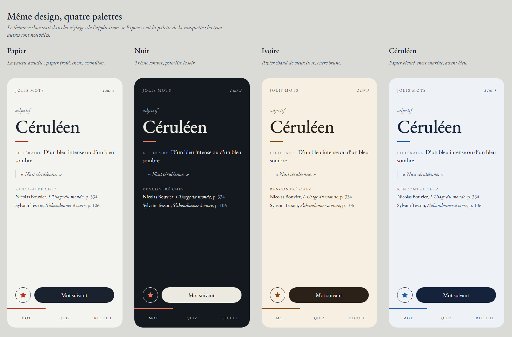

# Jolis Mots

Un recueil de mots français rares ou beaux, à apprendre dans les moments creux. On ouvre l'application, un mot s'affiche tout de suite avec sa définition ; on en lit cinq ou six, puis un quiz aide à les retenir.

*In English: Jolis Mots is a personal Android and Windows app for learning rare and beautiful French words, collected from dictionaries of rare words and from writers such as Nicolas Bouvier and Sylvain Tesson. The app and its documentation are in French.*

> **État : en construction.** La conception est validée et la maquette est faite. L'application elle-même n'est pas encore construite ; aucune version n'est publiée.



*Maquette de l'écran d'ouverture, dans les quatre palettes prévues. Les captures de l'application réelle remplaceront cette image.*

## Ce que fera l'application

| Écran | Rôle |
| --- | --- |
| **Mot** | L'écran d'ouverture. Un mot en grand, sa nature, ses sens, un exemple, et les livres où il a été rencontré. |
| **Quiz** | Une définition et quatre mots au choix, ou l'inverse. Les mots ratés reviennent plus souvent, jusqu'à ce qu'ils tiennent. |
| **Recueil** | La liste alphabétique, avec recherche et filtres par auteur et par favoris. |
| **Atelier** | Sous Windows seulement : ajouter, modifier et supprimer des mots, puis envoyer la liste au téléphone. |

Deux formes sont prévues : une application **Android**, la plus importante, et une application **Windows** qui contient en plus l'atelier.

## D'où viennent les mots

La liste compte environ 2 500 mots, relevés au fil des lectures : dictionnaires de mots rares (Didier Méral, François Rollin) et récits de Nicolas Bouvier, Sylvain Tesson et d'autres. Un peu plus de 1 100 ont déjà leur définition ; les autres restent à compléter dans l'atelier.

Les définitions et les phrases d'exemple sont reprises du [Trésor de la langue française informatisé](https://www.cnrtl.fr/definition/), consulté sur le site du CNRTL.

## Détails techniques

Ce qui est décidé à ce stade :

- **Une seule application web**, en TypeScript et Svelte, fabriquée avec Vite. Capacitor l'emballe en APK pour Android ; Electron en fait une application Windows.
- **Une seule liste de mots**, `mots.json`. Chaque mot garde le texte de sa définition tel qu'il a été saisi, avec ses balises (`1.`, `[Litt.]`, `EX:`, `SYN:`). Une fonction unique découpe ce texte pour l'affichage et pour le quiz.
- **Publication en ligne** : l'atelier dépose la liste sur la branche `donnees` de ce dépôt. Le téléphone la récupère à l'ouverture quand il a du réseau, et fonctionne hors ligne sinon.
- **Les progrès restent sur l'appareil** : mots vus, cases de mémoire, favoris, réglages.
- **Une seule police**, EB Garamond, embarquée dans l'application, et quatre palettes au choix.

Le détail est dans la [conception](docs/superpowers/specs/2026-11-24-jolis-mots-design.md). Les fichiers de la [maquette](docs/superpowers/specs/maquette/) sont conservés à côté, avec les [autres designs envisagés](docs/superpowers/specs/maquette/variantes.html).

## Versions et notes de version

Chaque changement visible pour l'utilisateur donne une version, inscrite dans le [journal des modifications](CHANGELOG.md) et publiée sur GitHub avec les mêmes notes. [VERSIONING.md](VERSIONING.md) explique comment une version est numérotée et publiée.

## Structure du dépôt

```text
jolis-mots/
|-- docs/
|   |-- captures/           # images du README
|   `-- superpowers/specs/  # conception et maquette
|-- .github/workflows/      # publication d'une version à chaque étiquette
|-- CHANGELOG.md            # journal des modifications
|-- VERSIONING.md           # règles de version et de publication
|-- CLAUDE.md               # consignes pour les assistants
`-- README.md
```

La branche `donnees` ne contiendra que la liste des mots, `mots.json`.
