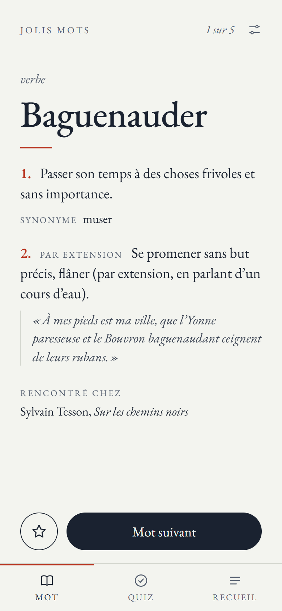
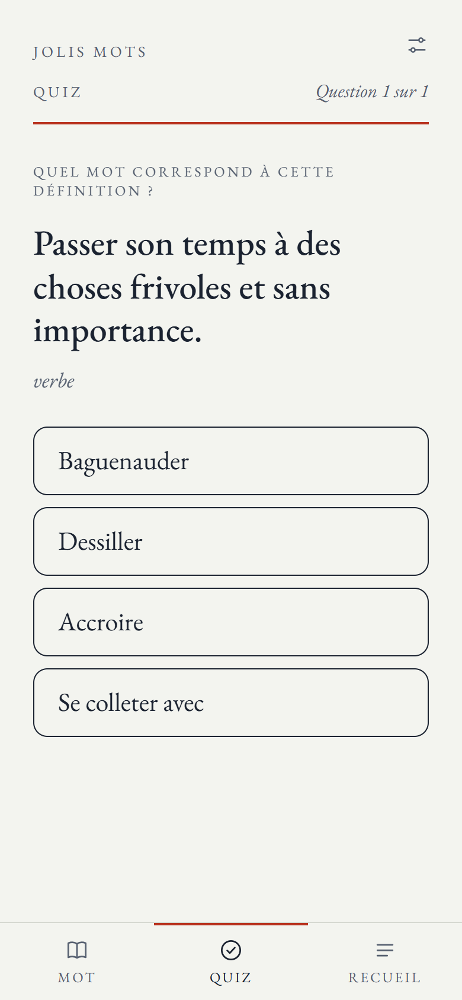
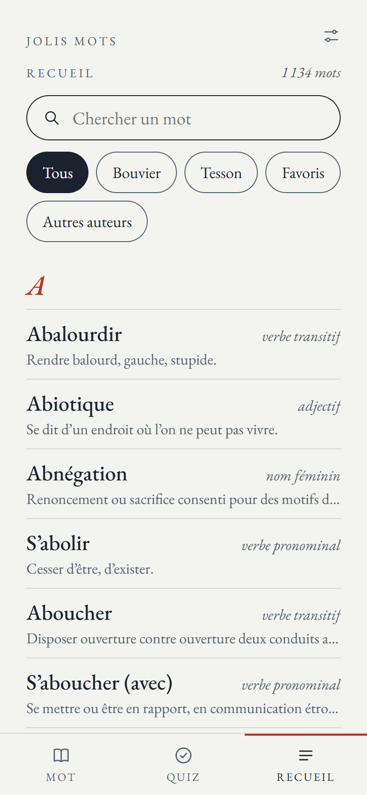

# Jolis Mots

Un recueil de mots français rares ou beaux, à apprendre dans les moments creux. On ouvre l'application, un mot s'affiche tout de suite avec sa définition ; on en lit cinq ou six, puis un quiz aide à les retenir.

*In English: Jolis Mots is a personal Android app for learning rare and beautiful French words, collected from dictionaries of rare words and from writers such as Nicolas Bouvier and Sylvain Tesson. The app and its documentation are in French. A Windows version with an editing workshop is planned for version 1.0.0.*

<p>
  
  
  
  
</p>

*Les écrans Mot, Quiz, Recueil et Réglages, dans la palette Papier.*


*Les quatre palettes. Un cinquième choix, « Comme le système », prend Papier le jour et Nuit quand le téléphone est en mode sombre.*

## Installer

L'application existe pour Android. Elle n'est pas sur le Play Store.

1. Sur le téléphone, ouvrir la [page des versions](https://github.com/iago-swi/jolis-mots/releases) et télécharger le fichier `Jolis-Mots-X.Y.Z.apk` de la dernière version.
2. L'ouvrir. Android demande d'autoriser l'installation d'applications venant de cette source (le navigateur ou le gestionnaire de fichiers qui a servi au téléchargement) : l'accepter.
3. Installer. L'application s'appelle « Jolis Mots ».

Le fichier est signé avec une clé de développement, pas avec une clé du Play Store : Android le signale, c'est normal.

## Utiliser

L'application s'ouvre sur un mot, sans menu à traverser. Trois onglets en bas : Mot, Quiz, Recueil. Les réglages s'ouvrent par l'icône en haut à droite.

### Mot

Le mot en grand, sa nature, ses sens, un exemple, et les livres où il a été rencontré. « Mot suivant » (ou un glissement du doigt vers la gauche) en montre un autre, un glissement vers la droite revient au précédent. L'étoile met le mot en favori.

Une séance compte cinq mots par défaut. Quand elle est finie, deux boutons : « Encore un mot » et « Passer au quiz ».

### Quiz

Une question à la fois, quatre réponses au choix : soit une définition à rattacher à son mot, soit un mot dont il faut retrouver le sens. Dans la définition, le mot est caché. Après la réponse, l'application dit si elle est juste ; il n'y a ni points ni série.

Le quiz pose d'abord les questions sur les mots de la séance, puis sur cinq mots à revoir au plus.

### Recueil

Tous les mots qui ont une définition, par ordre alphabétique. On peut chercher un mot (sans se soucier des accents ni des majuscules), ne garder que les mots rencontrés chez Bouvier ou chez Tesson, ceux d'un autre auteur, ou les favoris. Toucher un mot ouvre sa fiche.

### Réglages

- **Mots par séance** : 5, 6, 8 ou 10.
- **Palette** : Comme le système, Papier, Nuit, Ivoire ou Céruléen.
- La version de l'application et la date de la liste des mots.
- **Effacer mes progrès** : efface les mots vus, les révisions et les favoris, après confirmation.

### Comment la mémoire ramène les mots

Chaque mot vu entre dans la case 1 et devient à revoir un jour plus tard : le quiz le pose alors, parmi cinq mots à revoir au plus. Une bonne réponse le fait monter d'une case, et il revient de plus en plus tard : après 1, 3, 7, 16 puis 35 jours. Réussi une dernière fois depuis la case 5, il est acquis et ne revient plus. Une mauvaise réponse le renvoie en case 1.

Les progrès, les favoris et les réglages restent sur le téléphone. Ils ne sont pas envoyés ailleurs.

### La liste en ligne

La liste des mots est dans l'application : elle fonctionne sans réseau. Quand le téléphone est connecté, l'application regarde au démarrage si une liste plus récente est publiée ici même, sur la branche `donnees`. Si oui, elle la garde et l'adopte au prochain mot qu'elle tire. Sans réseau, rien ne change et rien n'est signalé.

## D'où viennent les mots

La liste compte environ 2 500 mots, relevés au fil des lectures : dictionnaires de mots rares (Didier Méral, François Rollin) et récits de Nicolas Bouvier, Sylvain Tesson et d'autres. Un peu plus de 1 100 ont déjà leur définition ; seuls ceux-là apparaissent dans l'application. Les autres restent à compléter.

Les définitions et les phrases d'exemple sont reprises du [Trésor de la langue française informatisé](https://www.cnrtl.fr/definition/), consulté sur le site du CNRTL.

## Détails techniques

L'application est écrite en TypeScript et Svelte, fabriquée avec Vite et emballée en APK par Capacitor. Toute la logique (lecture des définitions, mémoire, quiz, recherche) est dans un paquet à part, testé. Le détail est dans [PROJET.md](PROJET.md) : architecture, format de `mots.json`, mémoire et quiz, mise à jour en ligne, import depuis l'Excel, commandes, fabrication de l'APK.

La [conception](docs/superpowers/specs/2026-11-24-jolis-mots-design.md) explique les choix. Les fichiers de la [maquette](docs/superpowers/specs/maquette/) sont conservés à côté, avec les [autres designs envisagés](docs/superpowers/specs/maquette/variantes.html).

## Versions et notes de version

Chaque changement visible pour l'utilisateur donne une version, inscrite dans le [journal des modifications](CHANGELOG.md) et publiée sur GitHub avec les mêmes notes. [VERSIONING.md](VERSIONING.md) explique comment une version est numérotée et publiée.

La version 0.1.0 est la première : l'application Android. La version Windows et l'atelier, qui permettra d'ajouter, de modifier et de supprimer des mots puis d'envoyer la liste au téléphone, viendront avec la version 1.0.0.

## Structure du dépôt

```text
jolis-mots/
|-- packages/core/          # la logique, sans interface, avec ses tests
|-- apps/
|   |-- web/                # l'application (Svelte, Vite)
|   `-- android/            # l'enveloppe Android (Capacitor), icône et fabrication de l'APK
|-- tools/import/           # import de la liste depuis l'Excel
|-- scripts/                # captures d'écran du README
|-- docs/
|   |-- captures/           # images du README
|   `-- superpowers/        # conception, plan et maquette
|-- .github/workflows/      # publication d'une version à chaque étiquette
|-- CHANGELOG.md            # journal des modifications
|-- VERSIONING.md           # règles de version et de publication
|-- PROJET.md               # notes techniques
|-- CLAUDE.md               # consignes pour les assistants
|-- version.ts              # numéro de version, lu par Vite
`-- README.md
```

La branche `donnees` ne contient que la liste des mots, `mots.json`. Pour travailler sur le code, on la monte dans le dossier `donnees/` (voir [PROJET.md](PROJET.md)).
