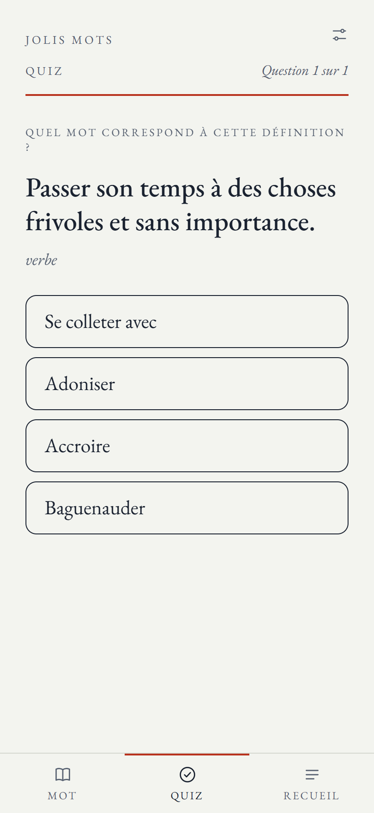
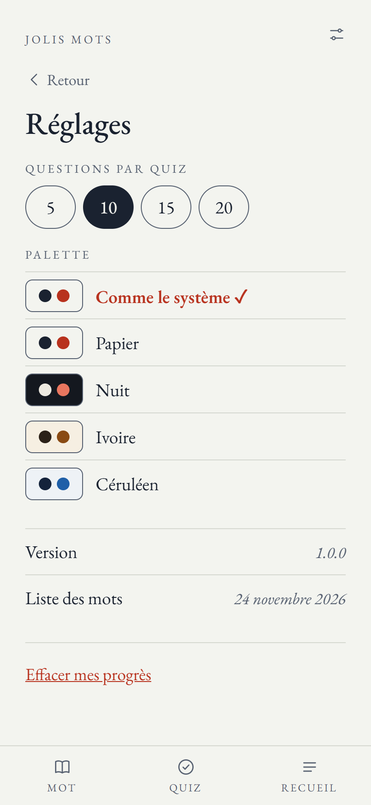
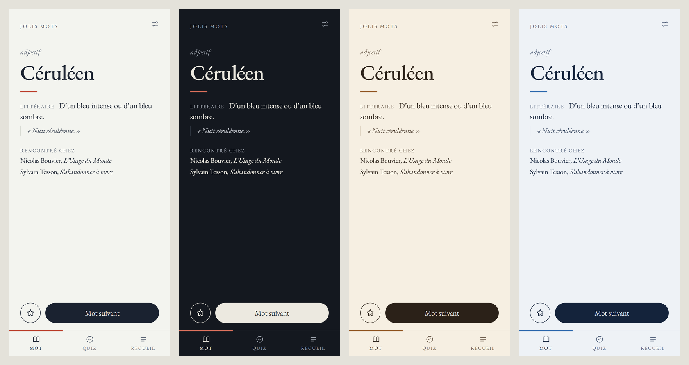

# Jolis Mots

Un recueil de mots français rares ou beaux, à apprendre dans les moments creux. On ouvre l'application, un mot s'affiche tout de suite avec sa définition ; on passe au suivant quand on veut, et un quiz aide à les retenir. Sous Windows, un atelier permet d'ajouter et de modifier les mots, puis d'envoyer la liste au téléphone.

*In English: Jolis Mots is a personal app for Android and Windows for learning rare and beautiful French words, collected from dictionaries of rare words and from writers such as Nicolas Bouvier and Sylvain Tesson. The Windows version adds a workshop for adding and editing words and sending the list to the phone. The app and its documentation are in French.*

<p>
  
  
  
  
  
</p>

*Les écrans Mot, Quiz (le choix, puis une question), Recueil et Réglages, dans la palette Papier.*


*L'atelier, sous Windows : la liste des mots, la fiche à remplir, avec la barre de balises et une remarque du vérificateur, et l'aperçu sur le téléphone.*



*Les quatre palettes. Un cinquième choix, « Comme le système », prend Papier le jour et Nuit quand l'appareil est en mode sombre.*

## Installer

L'application existe pour Android et pour Windows. Les fichiers à installer sont sur la [page des versions](https://github.com/iago-swi/jolis-mots/releases).

### Android

L'application n'est pas sur le Play Store.

1. Sur le téléphone, ouvrir la page des versions et télécharger le fichier `Jolis-Mots-X.Y.Z.apk` de la dernière version.
2. L'ouvrir. Android demande d'autoriser l'installation d'applications venant de cette source (le navigateur ou le gestionnaire de fichiers qui a servi au téléchargement) : l'accepter.
3. Installer. L'application s'appelle « Jolis Mots ».

**Venir de la version 0.1.0.** Depuis la version 1.0.0, l'application est signée avec une nouvelle clé : Android refuse de l'installer par-dessus la 0.1.0. Désinstaller d'abord Jolis Mots 0.1.0, puis installer la nouvelle version. La désinstallation efface les progrès et les favoris gardés sur le téléphone. Ce n'est à faire qu'une fois.

### Windows

Deux fichiers au choix, sur la page des versions :

- `Jolis-Mots-X.Y.Z-setup.exe`, l'installeur, qui laisse choisir le dossier d'installation ;
- `Jolis-Mots-X.Y.Z-portable.exe`, la version portable : un seul fichier, qui se lance sans installation.

L'application n'est pas signée : Windows prévient que l'éditeur est inconnu, c'est normal.

L'atelier a besoin de `git`, installé sur la machine et autorisé à envoyer sur ce dépôt. Il s'en sert pour recevoir la liste des mots au premier lancement (une connexion est alors nécessaire) et pour l'envoyer. L'application ne demande ni ne garde aucun mot de passe. Sans `git`, les écrans Mot, Quiz et Recueil fonctionnent avec la liste fournie avec l'application, et l'atelier dit ce qui lui manque.

## Utiliser

L'application s'ouvre sur un mot, sans menu à traverser. Trois onglets en bas : Mot, Quiz, Recueil ; sous Windows, un quatrième, Atelier. Les réglages s'ouvrent par l'icône en haut à droite.

### Mot

Le mot en grand, sa nature, ses sens, un exemple, et les livres où il a été rencontré. « Mot suivant » (ou un glissement du doigt vers la gauche) en montre un autre, un glissement vers la droite revient au précédent. L'étoile met le mot en favori.

La lecture n'a pas de fin : ni séance, ni compteur. Le quiz attend dans son onglet.

### Quiz

L'onglet s'ouvre sur un choix :

- **Tous les mots** : les questions portent sur des mots tirés au hasard parmi tous ceux qui ont une définition ;
- **Les mots que j'ai vus** : les questions portent sur les mots déjà rencontrés et pas encore acquis ; ceux qui sont à revoir passent d'abord.

Chaque choix indique combien de mots il couvre. Un quiz compte 10 questions, ou 5, 15 ou 20 selon les réglages ; moins si le choix couvre moins de mots.

Une question à la fois, quatre réponses au choix : soit une définition à rattacher à son mot, soit un mot dont il faut retrouver le sens. Dans la définition, le mot est caché. Après la réponse, l'application dit si elle est juste ; il n'y a ni points ni série. À la fin, « Encore un quiz » ou « Lire des mots ». Quitter l'onglet abandonne le quiz en cours ; les réponses déjà données sont gardées.

### Recueil

Tous les mots qui ont une définition, par ordre alphabétique. On peut chercher un mot, sans se soucier des accents ni des majuscules. Les filtres, sur une ligne, ne gardent que les mots rencontrés chez Bouvier, Tesson ou Rollin, les favoris (l'étoile), ou les mots d'un autre auteur : « Autres » ouvre la liste des auteurs, avec le nombre de mots de chacun. Un seul filtre est allumé à la fois ; le toucher de nouveau l'éteint. Toucher un mot ouvre sa fiche.

### Réglages

- **Questions par quiz** : 5, 10, 15 ou 20.
- **Palette** : Comme le système, Papier, Nuit, Ivoire ou Céruléen.
- La version de l'application, et la date et l'heure de la liste des mots.
- **Historique de la liste** : chaque liste reçue, de la plus récente à la plus ancienne, avec sa date, ce qui a changé (« +3 · ~1 · −1 ») et le nombre de mots. Une entrée se déplie : « + » pour un mot ajouté, « ~ » pour un mot modifié, « − » pour un mot supprimé. Toucher un mot ajouté ou modifié ouvre sa fiche. Sur le téléphone, l'historique commence quand la version 1.0.2 s'installe ; une réinstallation le remet à zéro. Sous Windows, il est tiré de la liste en ligne (voir l'atelier, plus bas).
- **Effacer mes progrès** : efface les mots vus, les révisions et les favoris, après confirmation.

### Atelier (Windows)

L'atelier tient sur trois colonnes.

- **À gauche, la liste** de tous les mots, complets ou non, avec une recherche et cinq filtres, chacun avec son nombre de mots : Tous les mots, Complets, À compléter, À vérifier et Doublons. À vérifier réunit les mots complets qui ont une remarque du vérificateur, et les mots qui ont une proposition de correction (voir plus bas). Doublons réunit côte à côte les mots qui ont le même mot ou le même tri, pour choisir lequel garder ; une recherche y garde les groupes entiers. « Nouveau mot » ouvre une fiche vide ; « Charger des propositions… » est juste en dessous.
- **Au centre, la fiche** : sur la première ligne Mot, Tri, Genre, puis deux petits champs, **Note** et **Util.** (« Utilisé dans mes livres » : L, LL, LLL ou X), dont le nom entier apparaît au survol ; ensuite Définition et Source. Dans une fenêtre étroite, Genre, Note et Util. passent sur une deuxième ligne, pour que le genre le plus long tienne en entier. Le tri est proposé à partir du mot et reste modifiable ; le genre propose les valeurs déjà employées. La définition s'écrit comme dans l'Excel, avec les balises habituelles (`1.`, `2.`, `[Litt.]`, `EX:`, `SYN:`, `US:`), rappelées au survol du titre « Définition », et la source prend une ligne par livre, sous la forme `Auteur: Titre (page)`. Un avertissement apparaît si le mot ou le tri existe déjà.
- **À droite, l'aperçu** : la fiche telle qu'elle apparaîtra sur le téléphone, mise à jour pendant la saisie.

Sous la fiche, toujours visibles et sur une ligne : la case **À compléter**, **Ouvrir dans le CNRTL**, qui ouvre l'article du mot dans le navigateur, **Supprimer ce mot**, après confirmation, et **Enregistrer** (ou Ctrl+S), inactif tant que rien n'a changé. Dans une fenêtre étroite, les deux liens se disent « CNRTL » et « Supprimer ». Tant que la case « À compléter » est cochée, le mot reste dans l'atelier et n'apparaît pas sur le téléphone ; elle est cochée d'office pour un nouveau mot. Quitter une fiche modifiée sans l'enregistrer demande confirmation, de même que recharger ou fermer la fenêtre.

#### Saisie rapide

Au-dessus de la définition, une barre de balises : `1.`, `[Litt.]`, `[Fig.]`, `[Par ext.]`, `[Vieux]`, `[Fam.]`, `EX:`, `SYN:`, `US:`, et « ⋯ », qui montre les autres. Un clic insère la balise au curseur, et le curseur reste dans la définition. Au survol, chaque bouton montre son abréviation.

Les mêmes balises se tapent au clavier : écrire l'abréviation, puis appuyer sur Tab. Elle est remplacée quand elle suit une espace, un début de ligne ou le début du texte, en minuscules ou en majuscules. Sinon, Tab passe au champ suivant, comme d'habitude. Ctrl+Z annule une insertion comme une frappe.

| Abréviation | Devient |
| --- | --- |
| `litt`, `fig`, `ext` | `[Litt.] `, `[Fig.] `, `[Par ext.] ` |
| `anal`, `meto`, `meta` | `[Par anal.] `, `[Par méton.] `, `[Par métaph.] ` |
| `vx`, `vi`, `fam` | `[Vieux] `, `[Vieilli] `, `[Fam.] ` |
| `pej`, `pop`, `rare` | `[Péj.] `, `[Pop.] `, `[Rare] ` |
| `ex`, `syn`, `us`, `ant` | `EX: `, `SYN: `, `US: `, `ANTON: ` |
| `n` | un retour à la ligne et le numéro du sens suivant (`2. ` après un `1.`) |

Le bouton `1.` fait comme `n` : en début de ligne, il ne pose que le numéro.

#### Vérificateur

Le vérificateur relit les mots complets. Dans la fiche, entre la première ligne et la définition, une ligne par remarque :

- balise mal écrite (`EX :`, `Ex:`, `Syn:`, `SYN.:`) ;
- indication entre crochets écrite autrement que d'habitude (`[littér.]` quand `[Litt.]` est connu) ;
- indication hors crochets en tête d'un sens (« Fig. », « Sens figuré », « fauconnerie Oiseau ») ;
- numérotation des sens qui saute ou ne commence pas à 1 ;
- crochet, parenthèse ou guillemet sans pendant ; `EX:` sans exemple ;
- genre vide, ou inconnu ;
- espace double, ou espace avant un point ou une virgule (la remarque cite les passages, trois au plus) ;
- point final manquant à la fin d'un sens ;
- mots inconnus du dictionnaire français (sous Windows ; voir plus bas).

**Corriger** répare une balise mal écrite, des espaces en trop ou un point final manquant. Le texte ne change que sur ce clic, rien n'est enregistré avant **Enregistrer**, et Ctrl+Z rend le texte d'avant. **C'est voulu** fait taire cette sorte de remarque pour ce mot, durablement : elle ne revient pas, même si la définition change encore. Cela vaut sur cet ordinateur ; pour un mot inconnu du dictionnaire, seuls les mots signalés à ce moment se taisent. Au-delà de trois lignes, « et N autres » montre le reste.

#### Propositions de correction

Une relecture des définitions peut donner un fichier de propositions de correction (un fichier `.json`). Pour le charger : **Charger des propositions…**, sous la liste, puis choisir le fichier. L'atelier dit combien de propositions sont à traiter, et le filtre À vérifier les compte.

Chaque proposition apparaît dans la fiche de son mot, avec les remarques : le passage tel qu'il est, une flèche, le passage corrigé, puis la raison. Un « ? » signale une proposition incertaine. **Corriger** l'applique à la fiche, qu'il faut ensuite enregistrer ; **Non** l'écarte, et elle ne revient pas, même si le fichier est chargé de nouveau. Une proposition dont le passage n'est plus dans la définition ne s'affiche pas. Les propositions chargées restent gardées sur l'ordinateur.

#### Orthographe

Sous Windows, le correcteur souligne les fautes en français pendant la saisie. Le vérificateur demande au même dictionnaire les mots de chaque définition, et ajoute une remarque « Mot inconnu du dictionnaire » ; les mots rares de la liste y tombent souvent, d'où **C'est voulu**. Les noms propres en cours de phrase, les abréviations (« fam. », « qqn ») et les formes du mot de la fiche ne sont pas signalés.

Ce dictionnaire est celui de Windows : il n'y a rien à installer si le français fait partie des langues de Windows. Sinon, l'ajouter depuis les Paramètres de Windows, Heure et langue, Langue et région, puis Ajouter une langue (les libellés peuvent varier un peu selon la version de Windows) ; choisir **Français (Suisse)**, **décocher « Définir comme langue d'affichage de Windows »**, installer, puis relancer Jolis Mots. Sans français, le vérificateur ne signale aucun mot inconnu, et tout le reste fonctionne.

#### Historique sous Windows

Sous Windows, l'écran « Historique de la liste » des Réglages est tiré de la copie de la liste en ligne que garde l'atelier : chaque liste envoyée y est comparée à la précédente, depuis le premier import (les 200 dernières au plus). La lecture se fait sans réseau, sur ce que l'atelier a déjà reçu. Sans copie, ou si la lecture échoue, l'écran montre l'historique noté sur l'ordinateur. Le téléphone garde le sien.

Un mot enregistré apparaît aussitôt dans les écrans Mot, Quiz et Recueil de Windows. Pour le téléphone, il faut l'envoyer : en haut, l'atelier compte les mots ajoutés, modifiés ou supprimés depuis le dernier envoi, à côté du bouton **Envoyer au téléphone**. Après l'envoi, il dit : « Liste envoyée. Le téléphone la verra dans quelques minutes. »

Si l'envoi échoue, faute de réseau ou parce que GitHub le refuse, l'atelier le dit et les modifications restent en attente. Si la liste en ligne a changé ailleurs, rien n'est envoyé : **Reprendre la liste en ligne** met d'abord la version de l'atelier de côté, dans un fichier daté dont il montre le chemin, puis prend la liste en ligne. L'atelier n'écrase jamais la liste en ligne.

### Comment la mémoire ramène les mots

Chaque mot vu entre dans la case 1 et devient à revoir un jour plus tard. Une bonne réponse sur un mot à revoir le fait monter d'une case, et il revient de plus en plus tard : après 1, 3, 7, 16 puis 35 jours. Une bonne réponse sur un mot qui n'est pas encore à revoir ne change rien : refaire un quiz le même jour ne fait pas brûler les étapes. Réussi une dernière fois depuis la case 5, le mot est acquis et ne revient plus dans « Les mots que j'ai vus ». Une mauvaise réponse le renvoie en case 1.

Un mot rencontré pour la première fois dans « Tous les mots » entre en case 1, quelle que soit la réponse ; il reste à lire sur l'écran Mot.

Les progrès, les favoris et les réglages restent sur l'appareil. Ils ne sont pas envoyés ailleurs, ni partagés entre le téléphone et Windows.

### La liste en ligne

La liste des mots est dans l'application : elle fonctionne sans réseau. Quand le téléphone est connecté, l'application regarde au démarrage si une liste plus récente est publiée ici même, sur la branche `donnees`. Si oui, elle la garde et l'adopte au prochain mot qu'elle tire. Sans réseau, rien ne change et rien n'est signalé. Sous Windows, c'est l'atelier qui reçoit la liste en ligne, avec `git`.

## D'où viennent les mots

La liste compte environ 2 500 mots, relevés au fil des lectures : dictionnaires de mots rares (Didier Méral, François Rollin) et récits de Nicolas Bouvier, Sylvain Tesson et d'autres. Un peu plus de 1 100 ont déjà leur définition ; seuls ceux-là apparaissent sur le téléphone. Les autres restent à compléter, dans l'atelier.

Les définitions et les phrases d'exemple sont reprises du [Trésor de la langue française informatisé](https://www.cnrtl.fr/definition/), consulté sur le site du CNRTL.

## Détails techniques

L'application est écrite en TypeScript et Svelte, fabriquée avec Vite, emballée en APK par Capacitor pour Android et par Electron pour Windows. Toute la logique (lecture des définitions, mémoire, quiz, recherche, atelier) est dans un paquet à part, testé. Le détail est dans [PROJET.md](PROJET.md) : architecture, format de `mots.json`, mémoire et quiz, mise à jour en ligne, atelier et copie locale de la liste, import depuis l'Excel, commandes, fabrication de l'APK et de l'installeur.

La [conception](docs/superpowers/specs/2026-11-24-jolis-mots-design.md) explique les choix. Les fichiers de la [maquette](docs/superpowers/specs/maquette/) sont conservés à côté, avec les [autres designs envisagés](docs/superpowers/specs/maquette/variantes.html).

## Versions et notes de version

Chaque changement visible pour l'utilisateur donne une version, inscrite dans le [journal des modifications](CHANGELOG.md) et publiée sur GitHub avec les mêmes notes. [VERSIONING.md](VERSIONING.md) explique comment une version est numérotée et publiée.

La version 0.1.0 était la première : l'application Android. La version 1.0.0 ajoute la version Windows et l'atelier.

## Structure du dépôt

```text
jolis-mots/
|-- packages/core/          # la logique, sans interface, avec ses tests
|-- apps/
|   |-- web/                # l'application (Svelte, Vite), atelier compris
|   |-- android/            # l'enveloppe Android (Capacitor), icône et fabrication de l'APK
|   `-- desktop/            # l'enveloppe Windows (Electron), copie locale de la liste, installeur
|-- tools/import/           # import de la liste depuis l'Excel
|-- scripts/                # captures d'écran du README, mise à jour de donnees/ avant une fabrication
|-- docs/
|   |-- captures/           # images du README
|   `-- superpowers/        # conception, plans et maquette
|-- .github/workflows/      # publication d'une version à chaque étiquette
|-- CHANGELOG.md            # journal des modifications
|-- VERSIONING.md           # règles de version et de publication
|-- PROJET.md               # notes techniques
|-- CLAUDE.md               # consignes pour les assistants
|-- version.ts              # numéro de version, lu par Vite
`-- README.md
```

La branche `donnees` ne contient que la liste des mots, `mots.json`. Pour travailler sur le code, on la monte dans le dossier `donnees/` (voir [PROJET.md](PROJET.md)).
